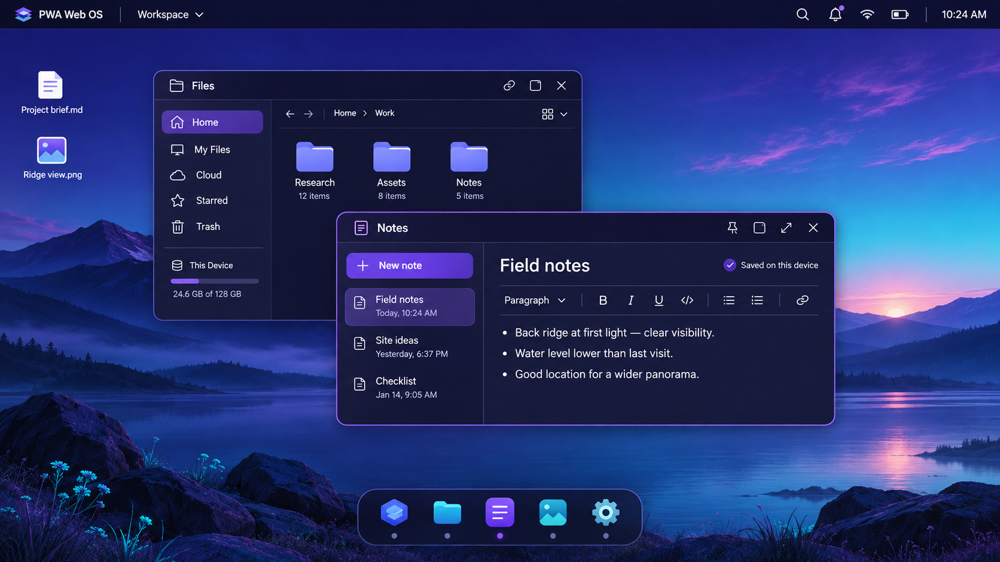

# Aurora Web OS Workspace Exploration

Status: Design exploration. Aurora is the selected long-term desktop direction. The [first release](PRODUCT_SPEC.md#first-release) remains Notes-only. App ideas and delivery slices below are proposed.

## Layouts to explore

| Layout | Composition | Best use |
| --- | --- | --- |
| Desktop | Wallpaper and file shortcuts behind floating windows. A slim top bar keeps workspace controls and app status visible; the bottom Dock launches apps and restores their windows. | Default on wider displays. Open Files behind Notes and bring either window forward with one action. |
| Split workspace | Two windows snap left and right. Keep the same top bar and Dock. Offer a window menu with Snap left, Snap right, Maximize, and Restore. | Read a file while editing a note. Use the menu with keyboard, click, or tap as an alternative to dragging. |
| Tablet | Use two tiled views when content fits, with a task switcher and larger touch targets. Collapse to one active view when the keyboard or rotation reduces space. | Browse files and preview them without positioning floating windows. |
| Phone | Use a full-screen active app, a visible back action, and a compact launcher or switcher that respects safe areas. | Open Files, preview an item, and return to Notes without resetting the draft. |

The workspace shell owns window bounds, stacking, focus, and restore. An app owns its task and content. Keep open/minimized/active states distinct. Reopening an already running app brings its window forward. Clamp restored bounds to the available viewport and return focus logically when a window closes. Keep launch, switching, snapping, and file moves available without drag gestures. [W3C guidance on dragging alternatives](https://www.w3.org/WAI/WCAG22/Understanding/dragging-movements)

## Files and software

| App or tool | First useful version | Dependency or limit |
| --- | --- | --- |
| Notes | Offline plain-text editing, local saves, recovery, and export. | Existing first-release scope and IndexedDB contract. |
| Files | Workspace folders, list/grid, rename, move, search by name, file import and export, and Open With. | Define a separate workspace file store and quota policy. File imports are user selected. Avoid taking a dependency on access to arbitrary operating-system folders. Keep Notes records in their existing store. |
| Preview | Read plain text and show common image formats from imported files. | File registry and media type validation. Give unsupported files a download action. |
| Calculator | Basic arithmetic, keyboard entry, and copy result. | Standalone offline tool. Useful as a low-complexity test app for window focus and switching. |
| Settings | Theme and wallpaper selection, workspace reset, and storage/backup guidance. | Use localStorage for small preferences. Resetting the layout preserves user files and notes. |
| Weather | Fetch a small result for user-entered or preset coordinates. | Owner-selected post-release second tool. Verify provider terms and browser access. Keep Notes independent of connectivity. See [Public-API reuse](UPSTREAM_REUSE.md#after-m5-public-api-tool). |
| 3D Viewer | Open an approved GLB with rotate, zoom, reset, and poster fallback. | Lazy-load the renderer and model. See the [Gallery pilot](BLENDER_GALLERY_REUSE.md#after-m5-one-model-viewer-pilot). |

Keep Aurora's file space inside the Web OS. The wallpaper, shortcuts, and file browser represent workspace content. Any battery, capacity, or connectivity indicators in the concept art need a verified data source before becoming real controls.

## Proposed delivery slices

1. **Finish the Notes release.** Deliver the existing offline, update, and data-transfer workflow.
2. **Prototype the shell.** Make the desktop, top bar, Dock, and two windows clickable. Use Notes and a stub Files window to test focus, stacking, close/restore, and snapping before committing to file storage. Test keyboard-only and touch paths and resize while a draft is open.
3. **Add the workspace file flow.** Import a sample file, show it in Files, open it in Preview, then export it. Check quota failure, conflict handling, and unsupported file types. Keep the Notes backup contract intact.
4. **Add tools in small slices.** Integrate the chosen Weather tool after the first release, and use Calculator or Settings to test reusable shell entry points. Add the heavier Viewer only after measuring that it leaves Notes startup and offline behavior intact.

The first Aurora review should answer two questions: whether Dock switching keeps the active window obvious, and whether the same Files-to-Preview flow works when the screen changes from floating windows to tiled or full-screen views.

## Feature anchors

These four images are proposed interaction references derived from the selected Aurora visual. They describe the later desktop work. Feature behavior comes from the acceptance column, with product scope governed by the product specification.

| Anchor | Features to build | Prototype acceptance |
| --- | --- | --- |
| [01 · Desktop and Dock](assets/aurora-anchor-01-shell.png) | Desktop surface, top bar, workspace shortcuts, static app registry, Dock indicators and an app switcher. | Launch Files and Notes. Switch focus, minimize Notes, and restore the same instance with its draft intact. |
| [02 · Files and Preview](assets/aurora-anchor-02-files-preview.png) | Workspace folders, breadcrumb, import, selection, Open With, separate Preview window, and export. | Import a sample PNG, find and preview it, then export the original bytes. Show a usable error for an unsupported or unavailable file. |
| [03 · Window snapping](assets/aurora-anchor-03-window-snap.png) | Focus, resize, snap left and right, maximize, and restore. Provide a window menu with keyboard and click or tap access. | Arrange Files and Notes side by side without dragging. Restore the previous bounds and keep the current note selected. |
| [04 · Tablet and phone](assets/aurora-anchor-04-adaptive.png) | Tablet two-pane layout, phone single active view, Back to Files, safe-area handling, and touch app switching. | Open the same file on both layouts. Rotate or narrow the viewport and return to Files without losing selection or the active Notes draft. |

Start with 01 and 03 using Notes and a placeholder Files window. Add the real file flow in 02 when the workspace file contract is agreed. Verify 04 throughout the prototype work and repeat it against the real flow once available.

Implement the app switcher from actual window state. In 01, Files is visible behind Notes and should be listed as open in the background, rather than minimized. The inherited Cloud entry, device indicators, capacity values, and rich-text controls are visual placeholders.
