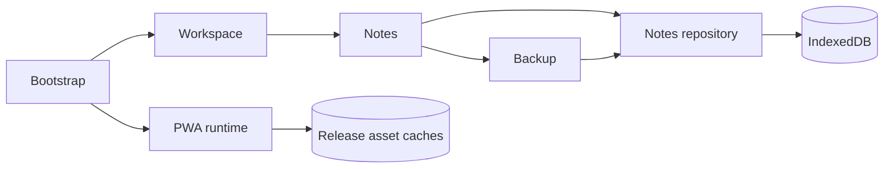

# Modular PWA Web OS Development Plan

Status: Proposed architecture and implementation plan. No application or runtime test evidence exists yet. The [product specification](PRODUCT_SPEC.md) owns release scope and acceptance criteria. [Task.md](../Task.md) tracks execution.

## Product direction

Build one deployable PWA with a workspace shell and one built-in app, Notes. Prove that a user can install it, create a note offline, recover it after reopening, update the app safely, and transfer the note to another device. Keep the Notes data format and app integration independent of the layout so future tools can reuse the workspace.

Use the `STATIC_OFFLINE` profile of KB-MCP `pwa:product-standard` v1.1.0. Use IndexedDB for notes and saved drafts and localStorage for small, non-sensitive UI preferences. TypeScript, a small static build, and semantic HTML/CSS are the proposed starting stack. Pin tooling versions when the scaffold exists. The first release needs one build, one origin, and no application backend.

## Module boundaries

Follow the [UI foundation](UI_FOUNDATION.md#module-ownership-and-parallel-delivery) for shared localization, tokens, and preference interfaces. Bootstrap wires these services without coupling Notes to their storage or presentation details.

| Module | Owns | Public boundary |
| --- | --- | --- |
| Bootstrap | Composition and configuration | Creates adapters and registers built-in apps. Owns wiring and startup error routing. |
| Workspace | Launcher, active app, responsive layout, focus, and workspace status surfaces | Opens a registered app by ID and gives it a mount point. Does not inspect note records. |
| Preferences | Namespaced localStorage keys, validation, and defaults | Reads and writes small UI preferences such as theme. Returns defaults on read failure and keeps the current choice in memory when writes fail. |
| Notes | Editor, draft snapshots, local save queue, and save/recovery UI | Mounts into the workspace, uses a Notes repository, and reports whether pending work can be flushed before a reload. |
| Notes storage | IndexedDB connections, schema upgrades, transactions, and record revisions | Lists and reads notes, saves one revision atomically, and imports a validated batch atomically. |
| Backup | Format version, parsing, validation, export, and import preview | Reads through the Notes repository and submits validated records through its batch contract. |
| PWA runtime | Manifest integration, offline app assets, worker registration, release status, and update coordination | Reports ready and waiting states. Requests a safe reload through the shell after the worker changes. |

Arrows show calls or wiring, rather than package ownership. Bootstrap injects the Notes entry and its dependencies. The shell uses the app descriptor interface, so it does not import Notes internals. The worker manages assets only. Notes records and release assets have separate lifecycles.

Proposed source layout: `src/workspace/`, `src/apps/notes/`, `src/storage/notes/`, `src/backup/`, and `src/pwa/`, wired from a single entry point. Keep the app registry a static list. Add shared modules once a second consumer demonstrates the need.

## Contracts and state

- **App entry**. A built-in descriptor supplies a stable ID, accessible label, and mount function. Mount returns disposal behavior to release listeners and timers. The shell restores focus when closing the app. The Notes entry contributes a pending-work callback for update coordination.
- **Repository**. A note carries a stable ID, title, body, and revision. Saving with an expected revision compares and commits inside the same transaction. The caller receives the committed revision or a typed failure such as conflict, quota, or storage unavailable. New notes use an insert precondition.
- **Editor**. Keep a snapshot for each in-flight save and serialize writes for each open note. An older save completing after a newer edit leaves the newer edit pending. Report “saved on this device” only after transaction completion for the current snapshot. On failure preserve unsaved text while the editor remains open and offer retry or copy. On a revision conflict, offer reload of the stored note or “save as new” for the user's draft.
- **Preferences**. Catch errors when obtaining or using localStorage. Ignore invalid values and use safe defaults. Keep note content and drafts in IndexedDB even when preference storage is unavailable. Treat browser and install contexts as potentially separate stores and use backup and restore to move notes between them.
- **Schema**. Version the IndexedDB schema separately from the backup format and release build. Run migrations in the database upgrade transaction and close old connections on version change. A blocked upgrade tells the user which action to take, such as closing other app tabs. It must never reset the database. Verify migration from the last supported schema, including a blocked and interrupted upgrade.
- **Backup**. Use an explicit format ID and version with a list of plain-text note records. Export committed data in a consistent snapshot and warn if there are unsaved edits. Validate size, structure, supported version, record IDs, text limits, and duplicate IDs before importing. Reject the whole batch on an ID collision with different content, including collisions discovered after preview. Treat an existing identical record as a no-op. Render all imported text as data.

The storage adapter relies on browser database transactions. Browser storage is subject to quota and can be removed by the browser or user, so offer export early and describe a local save as local. [IndexedDB specification](https://www.w3.org/TR/IndexedDB/) · [WHATWG Storage Standard](https://storage.spec.whatwg.org/)

## Offline and update lifecycle

1. Serve the app over HTTPS with a stable manifest identity, start URL, scope, and appropriate icons. Keep the complete launcher-to-Notes path in the offline asset set. Show “available offline” only when an installed worker controls the page and its release assets are ready.
2. Give each build a distinct ID and use immutable versioned assets. Keep deployment entry discovery fresh while pairing the offline document with the matching build assets. During install, populate a release-specific candidate cache and verify required assets. A failed install removes only the candidate cache and keeps the last usable build. Limit cache cleanup to this app and keep versions still needed by live clients.
3. When a waiting worker appears, show an update action. On acceptance, coordinate reachable app clients, flush pending edits, and prevent new edits during the switch. If any active client cannot confirm that it is safe to switch, defer and explain how to continue. Avoid unconditional `skipWaiting()`. A waiting worker may activate normally after old clients close, so startup must handle both paths without assuming an update button was pressed.
4. Subscribe before requesting activation. After the expected controller takes over, reload each participating client once and verify the build ID on startup. If the switch times out, restore usable controls without clearing notes. If the controller has already changed, offer a safe reload rather than claiming the old build is still active.
5. Keep the previous release artifacts for recovery and verify that an older client handles a newer schema safely. During a rollback, preserve the user's current database. If an older build cannot read that schema, ship a compatible forward fix instead of attempting a destructive downgrade.

The browser owns worker installation and activation. Test the app's coordination and recovery on devices, including background tabs and standalone mode. [W3C Service Workers](https://www.w3.org/TR/service-workers/)

## Interaction and security

- Narrow layout: one app view with a visible route back to the launcher. Wide layout: more space for the same workflow. Preserve the selected note when switching layouts. Defer floating windows until there is a second tool and a validated need for side-by-side work.
- Apply theme-aware opaque iOS chrome and safe-area insets. Verify focus, keyboard navigation, text zoom, contrast, reduced motion, and announced save and update states. Target WCAG 2.2 AA and run VoiceOver on a physical iPhone. [W3C WCAG 2.2](https://www.w3.org/TR/WCAG22/)
- Keep notes off the network. Serve a restrictive Content Security Policy appropriate to the build and render note content as text. Limit and validate file imports before reads and writes become expensive. Exclude note content and backup data from logs and diagnostics. Same-origin built-in modules share a trust boundary. A future third-party app model requires a separate isolation and permission design.

## Milestones and gates

| Milestone | Deliverable | Exit evidence |
| --- | --- | --- |
| M0: Baseline | Set exact target versions for the [platform matrix](PRODUCT_SPEC.md#platform-support). Record database schema, localStorage keys, limits, and build choices. Scaffold and document development commands. | Clean setup, build, and basic browser launch with recorded commands. |
| M1: Local Notes | Launcher, editor, save states, repository, preferences, and responsive layout. | Reopen a saved note. Simulate a failed write and verify retry. Edit in two clients and verify conflict handling. Verify keyboard, narrow layout, and preference fallback. |
| M2: Install and offline | Manifest, release asset cache, offline readiness, and platform-specific installation guidance. | On Windows, macOS, and physical iOS and Android devices, verify each required tab and app launch mode. After setup, disconnect, cold launch, edit, save, close, and reopen offline. |
| M3: Safe updates | Waiting prompt, multi-client coordination, recovery, and migration. | Test builds A and B: defer, accept with a dirty draft, recover after reload, exercise an unready client, and simulate a failed candidate and activation timeout. Verify prior data survives. Exercise a [previous-build asset request after deployment](BLENDER_GALLERY_REUSE.md#apply-to-the-first-release). |
| M4: Portability | Versioned export and atomic import. | Restore on another device. Verify malformed, oversized, incompatible, and conflicting backups leave existing data intact. Import the same backup twice and verify idempotent behavior. |
| M5: Release readiness | Full matrix, accessibility, performance, and recovery evidence. | Run [product acceptance](PRODUCT_SPEC.md#acceptance-criteria) and applicable KB gates. Exercise the release rollback or forward recovery procedure in a test environment. |

Build-bound evidence records the commit SHA, build ID, test ID, timestamp, device, OS, browser, launch mode, result, and artifact references. Keep lab and field performance results separate. Report missing field samples explicitly. Hold release on failed or unrun critical safety and compatibility checks. Desktop automation can cover regression paths. Physical iOS and Android app launch, iOS VoiceOver, and cross-device import remain explicit manual checks.

After M0, workspace and repository can progress in parallel against the agreed app and repository contracts. Join them in M1 before adding offline support. Backup parsing and validation can progress in parallel once the record and backup contracts are fixed. Integrate backup writes and update coordination against the same committed data in M4.

## Evolution after the first release

Use the [Aurora workspace plan](AURORA_WORKSPACE_PLAN.md) to prototype Dock switching and window focus before introducing a workspace file store. Keep the Notes data contract separate from the desktop layout and future file app.

Use a second built-in app to validate the entry contract before introducing a public extension API. Add multiple windows only after designing focus, navigation, and state restoration across mobile and desktop. Add sync after defining identity, conflict resolution, and retry semantics. Treat third-party apps and AI as separate capabilities with revocable permissions and explicit approval for consequential actions. Preserve versioned exports throughout.
