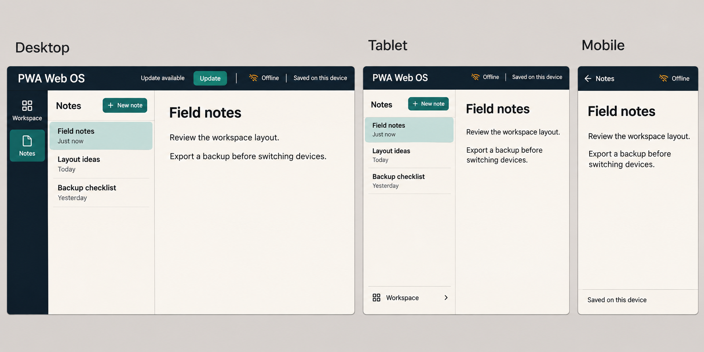

# PWA Web OS UI/UX Anchor

Status: Proposed v1 for owner review. This image illustrates the first-release Notes workspace. The [product specification](PRODUCT_SPEC.md) defines release requirements.

## Layout and navigation

| View | Layout | Interaction |
| --- | --- | --- |
| Desktop | Compact workspace rail, Notes list, and editor | Open Notes from the rail, switch between notes in the list, and keep editing while an update is available. |
| Tablet | Compact workspace control, list, and editor where space allows | Keep the selected note open when rotating. Switch to one pane when the list and editor cannot both remain usable. |
| Mobile | One screen at a time, with a visible return to the Notes list | Open a note in the focused editor, return to the list, then use the workspace entry to return to the launcher. Respect safe areas and the software keyboard. |

Use the same navigation labels and preserve the active note when the layout changes. Keep title and body editable with readable line lengths. The mockup establishes hierarchy, density, and placement. Choose actual breakpoints from content fit and device testing.

Use [SVG-Icon-Studio](https://github.com/yapweijun1996/SVG-Icon-Studio) as the source for the selected interface icons and [Loader Studio](https://github.com/yapweijun1996/Vanilla-HTML-Loader) for update progress. Bundle the selected assets with the app. Pair visual status with readable text and show a static progress indicator for reduced motion.

## States to implement and review

| State | Expected behavior |
| --- | --- |
| Empty Notes list | Provide a visible **New note** action and brief guidance. |
| Editing and saving | Show **Saving…** while the current draft is pending and **Saved on this device** after its IndexedDB transaction completes. |
| Offline | Show **Offline** separately from save feedback. The same editor and local save flow remain available after initial setup. |
| Save failed or conflicted | Preserve the draft on screen. Offer **Retry** or **Copy draft** on failure, and **Save as new** or reload the saved version on conflict. |
| Update available | Show a nonmodal update action on every viewport when a verified candidate is ready. The desktop example shows a candidate prepared before the connection was lost. Continue editing if the user defers. After acceptance, announce progress and preserve pending edits before reloading. |
| Backup and restore | Place these actions in a clearly labeled secondary menu. Preview an import, and explain invalid or conflicting data before any records are written. |

Use readable labels alongside icons and color. Expose changes to assistive technology without moving focus from the editor. Keep the update notice secondary to the current task. [W3C guidance on status messages](https://www.w3.org/WAI/WCAG22/Understanding/status-messages.html) · [GOV.UK notification banner](https://design-system.service.gov.uk/components/notification-banner/)

Verify touch targets, text zoom, light and dark themes, focus order, mobile safe areas, and the software keyboard in the actual app. A static mockup cannot establish those results. [Apple layout guidance](https://developer.apple.com/design/human-interface-guidelines/layout)

## Visual review

Self-review using the KB-MCP `ui:visual-design-lifecycle` rubric scored the design proposal **86/100**, eligible for owner review. The score covers the image and the written interaction design.

| Category | Score | Evidence |
| --- | --- | --- |
| User purpose | 13/15 | The same note is the main task in every layout. First-use and recovery actions are specified above. |
| Navigation | 9/10 | Desktop labels and mobile back action are visible. The mobile route to the launcher has yet to be prototyped. |
| Visual hierarchy | 14/15 | The note title and editor lead. The desktop header carries more status information than other views. |
| Layout and density | 9/10 | Panels have distinct purposes. The narrow view preserves space for writing. |
| Typography and copy | 9/10 | Labels and sample content are readable. Longer labels need reflow checks. |
| Feedback and recovery | 7/10 | Offline, saved, and update states are visible. Error recovery and progress are specified in text. |
| Responsive design | 9/10 | The layout changes from a rail and panes to a single focused view. Intermediate widths need testing. |
| Accessibility | 7/10 | Status uses text and the handoff defines focus and announcements. Keyboard, contrast, and assistive technology behavior need runtime checks. |
| Trust and state | 4/5 | The image is labeled as a proposal and distinguishes offline from saved. Failure states are specified separately. |
| Craft | 5/5 | Shared palette, labels, and panel hierarchy keep the views coherent. |

Owner approval is pending. Review empty and failure states, update progress, backup, and dark mode in the prototype or implementation.
